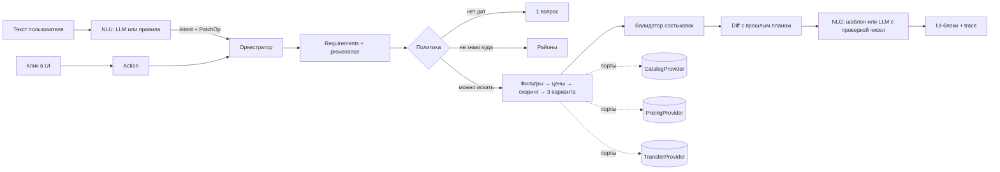

# Архитектура

## Главный принцип

**LLM понимает и формулирует. Код решает и считает.**

LLM превращает текст пользователя в структурированное намерение и изменения требований,
а в конце «очеловечивает» ответ. Всё остальное — фильтры, цены, ранжирование, проверка состыковок,
корзина — детерминированный код. Поэтому агент:

- не выдумывает цены и наличие (числа в тексте LLM проверяются по фактам, иначе — шаблон);
- воспроизводим (тесты и eval стабильны);
- работает даже без LLM (режим правил) — у жюри запустится при любом раскладе с ключами;
- встраивается в чужую систему как блок: наружу — HTTP API с типизированными UI-блоками.

## Модули и владельцы

| Модуль | Путь | Владелец | Что делает |
|---|---|---|---|
| Контракт | `backend/trip_agent/schemas/`, `ports.py` | все трое | типы данных, UI-блоки, действия, интерфейсы |
| Мозг | `agent/`, `llm/`, `requirements_ops.py` | ML1 | NLU, политика вопросов, оркестратор, NLG, пересборка |
| Данные | `catalog/`, `scripts/`, `data/` | ML2 | Location Pack: отели, POI, климат, районы |
| Цены | `pricing/` | ML2 | детерминированные DEMO-цены и наличие |
| Ранжирование | `ranking/` | ML2 | жёсткие фильтры, скоринг, архетипы, объяснения, ослабления |
| Состыковки | `validation/`, `transfer/` | ML2 | прибытие→заселение, выезд→отъезд, трансферы |
| Заказ | `booking/` | FS | корзина, заказ, имитация оплаты, запросы после покупки |
| API/хранилище | `api/`, `storage/`, `container.py` | FS | FastAPI, SQLite, сборка зависимостей |
| Фронт | `web/` | FS | чат + карточки + сравнение + diff + корзина |
| Качество | `eval/`, `backend/tests/` | ML2 + ML1 | сценарии, метрики, тесты |

## Один ход агента

1. **Вход**: текст → `Nlu.parse()` → `NluResult(intent, patch[])`; клик → `Action` (без LLM).
2. **Патч**: `apply_patch()` применяет операции к `Requirements` и помнит источник каждого поля
   (`user` / `assumed` / `default` / `profile`). Пути — из белого списка `PatchPath`.
3. **Политика** (`agent/policy.py`):
   - выводит «скрытые» требования (ребёнок → удобно с детьми + короткий трансфер);
   - спрашивает только «когда» (максимум 2 вопроса за сессию), остальное предполагает и показывает чипсами;
   - время прибытия спрашивает только после выбора варианта (когда оно реально нужно).
4. **Поиск** (`ranking/baseline.py`): фильтры → предложения на даты → бюджет → скоринг с весами
   из требований → 3 варианта-компромисса (баланс / выгоднее / комфортнее). Пусто → «ослабления»,
   посчитанные реальным перезапуском фильтров.
5. **Проверка** (`validation/rules.py`): состыковки, бюджет, вместимость, даты; фиксы — кнопками.
6. **Diff**: при пересборке сравниваем рекомендацию до и после и показываем, что сохранилось.
7. **Ответ**: `TurnResponse` = блоки + быстрые кнопки + `trace` (шаги и время) + текущие требования.

## Контракт (не ломать без согласования)

- `schemas/requirements.py` — `Requirements`, `PatchOp` (белый список путей), `NluResult`.
- `schemas/ui.py` — 10 типов блоков. Новый тип = правки бэка **и** фронта в одном PR.
- `schemas/actions.py` — действия из UI.
- `schemas/vocab.py` — закрытые словари. Новый `PrefKey` → обработчик в `ranking/prefs.py`
  (тест `test_every_pref_has_handler_and_label` упадёт, если забыть).
- После изменения схем: `python scripts/export_openapi.py && (cd web && npm run gen:types)`.

## Решения и отвергнутые варианты

Каждое решение записано с альтернативой и честной критикой — это и ответы на вопросы жюри.

### ADR-1. Детерминированный оркестратор, а не свободный ReAct-цикл или LangGraph
**Почему:** число вопросов предсказуемо (требование «не анкета»), цены не выдумываются,
ход стоит 1–2 вызова LLM (быстро и дёшево), поведение тестируемо.
**Отвергнуто:** ReAct-цикл с tool calling — непредсказуемые вопросы, выдуманные аргументы
инструментов, сложно тестировать. LangGraph — лишний слой: наш граф маленький, а
«чекпоинты» — это наш `SessionStore`.
**Критика и компенсация:** риск жёсткости на запросах вне сценариев. Компенсируем широким NLU (LLM),
`ask_info` с заземлённым ответом и безопасным откатом «расскажите подробнее». Если останется время —
LLM-выбор следующего действия **из закрытого списка** обработчиков (за флагом), с теми же гарантиями.

### ADR-2. Любое сообщение = intent + PatchOp
Первое сообщение — это патч к пустым требованиям, «а если на 2 дня позже» — патч `shift_days`.
Пересборка получается без отдельного механизма.
**Отвергнуто:** ручная карта зависимостей «поле → что пересчитать» — хрупко и избыточно на
данных в памяти (полный пересчёт занимает около 30 мс).
**Критика:** на реальном API поставщика полный пересчёт дорог. Ответ — мемоизация вызовов
`PricingProvider` по ключу (отель, даты, состав): инкрементальность получится сама.

### ADR-3. Ответ агента — типизированные UI-блоки
Любой клиент (веб, Telegram, виджет Островка) рисует одни и те же блоки.
**Отвергнуто:** markdown от LLM — нельзя построить сравнение, корзину и diff, нельзя переиспользовать.

### ADR-4. Порты и адаптеры; контент отдельно от цен
`CatalogProvider` (статический контент) и `PricingProvider` (цены и наличие на даты) разделены,
как в реальных B2B-API отелей. Подключить настоящего поставщика = написать два адаптера и
поменять строку в `container.py`.

### ADR-5. Данные: Location Pack, реальная основа, синтетика на лету
- Реальное: отели и POI из OpenStreetMap (ODbL), климат из Open-Meteo (CC BY 4.0) — собираются
  скриптами один раз и коммитятся. **Во время работы сеть не нужна.**
- Синтетика: цены, наличие, номера, рейтинги — генерируются детерминированно по seed и
  помечаются (`is_demo_price`, `provenance.synthetic_fields`).
- Цена считается на лету по хэшу (отель, дата): работают любые даты без календаря на год.

**Отвергнуто:** скрапинг (на Q&A назван серой зоной, ломается у жюри офлайн); Amadeus test API
(нестабилен, не про отели Сочи); Postgres/Supabase (лишний сервис у жюри).

### ADR-6. Ранжирование: жёсткие фильтры → взвешенная полезность → архетипы
- Нарушение жёсткого требования = отсечение, а не штраф. Неизвестное ≠ выполненное.
- Веса строятся из требований этого пользователя (приоритеты must / important / nice).
- Разбивка скора по критериям = объяснение «почему» и «чем жертвуем».
- Стабильность: при почти равном скоре остаётся отель из прошлой выдачи.

**Отвергнуто:** ранжирование LLM (невоспроизводимо, галлюцинации), learning-to-rank (нет данных),
эмбеддинги отзывов (тяжёлые зависимости в образе; вместо них — закрытый словарь тегов «настроения»).
**Критика:** веса эвристические — калибруем на eval (задача ML2).

### ADR-7. LLM не зависит от провайдера и не обязательна
OpenAI-совместимый клиент: OpenRouter, Ollama, vLLM — меняется только `.env`. Структурированный
вывод: `json_schema` → `json_object` → валидация Pydantic → 1 повтор с ошибкой → откат на правила.

### ADR-8. Политика уточнений
Обязательный вопрос только один — даты. Состав и бюджет предполагаем и показываем, вопрос о
прибытии откладываем до выбора варианта. Максимум 2 вопроса до первых вариантов.

### ADR-9. Безопасность
Белый список путей патча; текст пользователя — данные, а не инструкции; цены никогда не берутся
от LLM; проверка чисел в NLG; экранирование markdown во фронте; `.env` не попадает в git.
В eval есть сценарии с промпт-инъекциями.

### ADR-10. Фронт: Vite + React + TS, раздаётся тем же процессом
Один контейнер, одна команда. Типы генерируются из OpenAPI, ручное дублирование исключено.
**Отвергнуто:** Next.js (SSR не нужен, второй рантайм), Streamlit (не встраивается, слабый UI),
Telegram как основной интерфейс (сравнение и diff выразительнее в вебе; бот — вторым клиентом).

### ADR-11. Одна локация с районами как «направлениями»
На Q&A: достаточно одной локации, отели первичны, перелёты и трансферы — «неплохое дополнение».
Большой Сочи разбит на 7 районов (море и горы) — этап «вдохновения» работает внутри одной локации.
Транспорт: время и способ прибытия плюс оценка трансфера; билеты не продаём.

## Точки расширения (ответ на «как это переиспользовать»)

| Задача | Что сделать |
|---|---|
| Новая локация | `data/locations/<id>/location.json` + `build_climate.py` + `build_location.py` |
| Реальный поставщик отелей | адаптеры `CatalogProvider` + `PricingProvider`, строка в `container.py` |
| Другой канал (Telegram, виджет) | клиент к `/api/v1`, рисует те же блоки |
| Другая LLM | `.env`: `LLM_BASE_URL`, `LLM_MODEL` |
| Postgres вместо SQLite | реализация `SessionStore` + `BookingRepository` |
| MCP-сервер для других агентов | обернуть порты (search / rank / validate) в MCP-инструменты |
